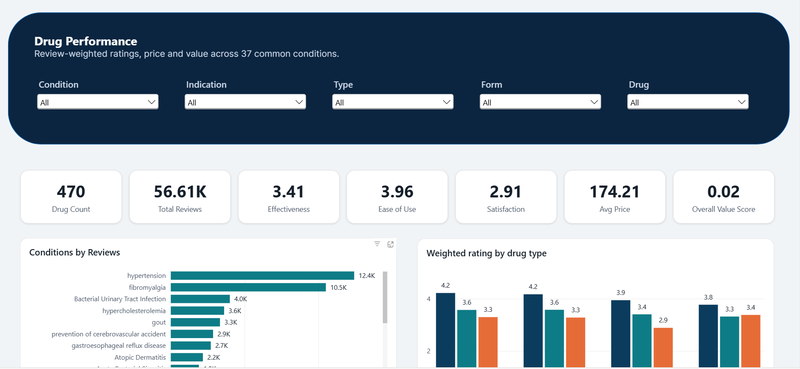

# Drug Performance Dashboard - Power BI
[Live Dashboard](https://app.powerbi.com/view?r=eyJrIjoiZDBhNDk0YmYtNjZiZS00NDE0LWFhOTYtY2UwODJiMGM2OGUyIiwidCI6ImM2ZTU0OWIzLTVmNDUtNDAzMi1hYWU5LWQ0MjQ0ZGM1YjJjNCJ9)



## Project Background
People choosing a drug usually see only a star rating. This project brings reviews, ratings, and price together so drugs for the same condition can be compared properly.

- **Source:** `Drug.csv`, hosted in this repository.
- **Ratings:** Effectiveness, ease of use, and satisfaction, based on customer reviews.
- **Extra Context:** Drug type, form, indication, and average price.

## Project Objective
This project aims to compare drug performance through data-driven insights, focusing on:

- **Review Volume:** Finding which conditions get the most reviews.
- **Rating Comparison:** Comparing OTC, RX, and RX/OTC drugs.
- **Price Analysis:** Understanding price by drug form.
- **Value for Money:** Spotting drugs with strong ratings at a low price.
- **Fair Ranking:** Weighting ratings by the number of reviews.

## Dataset Overview
The dataset covers **37 common conditions** and has **10 columns**:

| Column | Type | Description |
|---|---|---|
| Condition | Text | The medical condition associated with the drug |
| Drug | Text | Name of the drug |
| Indication | Text | The purpose of the drug |
| Type | Text | OTC, RX, RX/OTC (blank values are shown as "Unknown") |
| Form | Text | Form of the drug, e.g. tablet, capsule |
| Reviews | Whole number | Number of reviews |
| Effective | Whole number | Effectiveness rating from reviews |
| EaseOfUse | Whole number | Ease of use rating from reviews |
| Satisfaction | Whole number | Satisfaction rating from reviews |
| Price | Decimal number | Average price of the drug |

## Technologies Used
- **ETL, Modeling, Visualization:** Microsoft Power BI Desktop (Power Query, DAX)
- **Report Publishing:** Power BI Service
- **Data Hosting:** GitHub (raw CSV connection)

## Data Preparation
- Loaded `Drug.csv` through the Power BI **Web** connector using the raw GitHub file URL.
- Set data types, trimmed text columns, and replaced blank `Type` values with `Unknown`.
- Kept measures separate from calculated columns to avoid circular dependency errors.

## Key DAX Measures
Ratings are weighted by reviews, so a drug with 3,000 reviews counts for more than one with 3.

```DAX
Weighted Satisfaction =
DIVIDE(
    SUMX(Drug, Drug[Satisfaction] * Drug[Reviews]),
    SUM(Drug[Reviews])
)

Value Score = DIVIDE([Weighted Satisfaction], [Avg Price])

Overall Value Score =
DIVIDE(
    ([Weighted Effective] + [Weighted EaseOfUse] + [Weighted Satisfaction]) / 3,
    [Avg Price]
)

Satisfaction Level =
VAR s = [Weighted Satisfaction]
RETURN
SWITCH(
    TRUE(),
    ISBLANK(s), BLANK(),
    s < 1, "Very Unsatisfied",
    s < 2, "Unsatisfied",
    s < 3, "Partly Satisfied",
    s < 4, "More Than Satisfied",
    s <= 5, "Very Satisfied"
)
```

Other measures: `Total Reviews`, `Drug Count`, `Avg Price`, `Avg Effective`, `Avg EaseOfUse`, `Avg Satisfaction`, `Weighted Effective`, `Weighted EaseOfUse`.

## Dashboard Features
- **Slicers:** Condition, Indication, Type, Form, and Drug search.
- **KPI Cards:** Drug count, total reviews, weighted effectiveness, ease of use, satisfaction, average price, and overall value score.
- **Charts:** Top conditions by reviews, weighted ratings by type, effectiveness vs satisfaction scatter, review share by type, and price by form.
- **Table:** Best-value drugs ranked by Overall Value Score.

## Key Insights
- **Review Volume:** *Add your finding here.*
- **OTC vs RX:** *Add your finding here.*
- **Price vs Satisfaction:** *Add your finding here.*
- **Best Value:** *Add your finding here.*

## Key Learnings
- **Weight Ratings by Reviews:** A plain average treats a drug with 3 reviews like one with 3,000.
- **Set a Minimum Review Count:** Filtering out drugs with very few reviews keeps rankings reliable.
- **Clean Blanks Before Visuals:** Replacing empty values avoids confusing "(Blank)" labels.
- **Treat Value Scores as a Guide:** The score helps explore the data. It does not say which drug is right for a person.

## Conclusion
By weighting ratings with review counts and comparing them against price, this dashboard helps users explore which drugs perform well and which offer the best value across common conditions.

## How to Use This Repository
1. Clone the repository:
   ```bash
   git clone https://github.com/saurabhthorat999/<repo-name>.git
   ```
2. Open the `.pbix` file in Power BI Desktop, or explore `Drug.csv` directly.
3. If the data source asks for a path, update it in **Transform data → Data source settings**.
4. Use the slicers and charts to explore the data.

## Author
- [Saurabh Thorat](https://saurabhthorat999.github.io/n_portfolio/)  
- [LinkedIn](https://www.linkedin.com/in/saurabh-thorat-594b8b1aa/)
